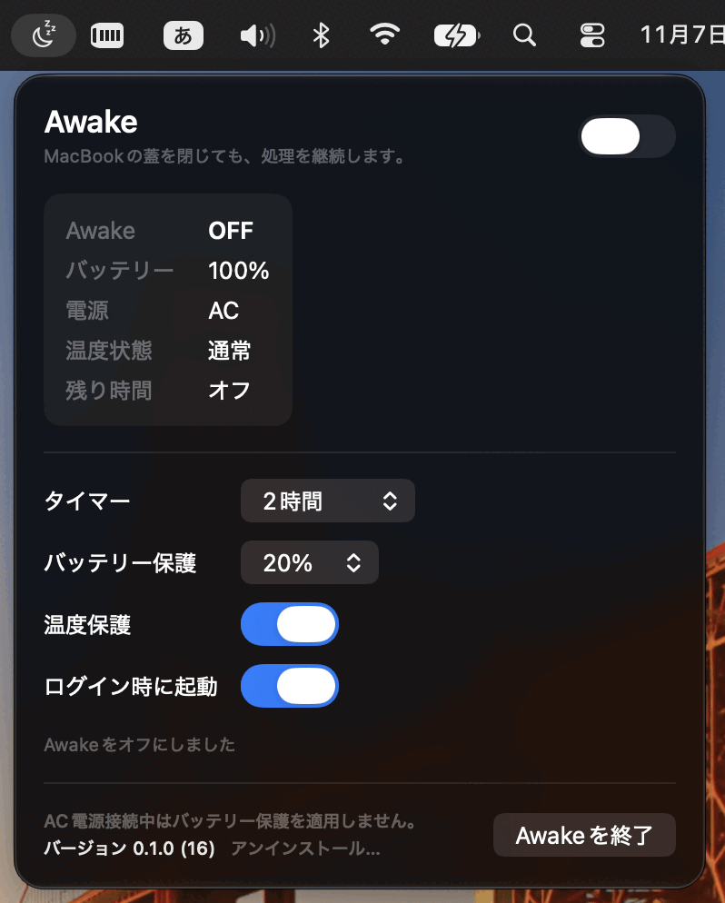

# Awake

Awake は MacBook の蓋を閉じている間もスリープを防ぐメニューバーアプリです。Mac 上で動かしている作業を、席を離れても続けたいときに使います。

たとえば、次のような使い方を想定しています。

- [Codex Remote](https://developers.openai.com/blog/mastering-codex-remote-for-engineering) でこの Mac を実行先にして、外出先から作業を進める
- [Claude Code Remote Control](https://code.claude.com/docs/en/remote-control) で、この Mac 上のセッションをスマートフォンなどから操作する
- SSH 接続、ビルド、ダウンロード、バックアップなどを続ける

AI の処理やコード実行がクラウド上で完結するセッションには、Awake は必要ありません。手元の Mac を実行先にする場合に使ってください。

## インストール

macOS 13 Ventura 以降の Apple シリコン搭載 Mac と Intel Mac に対応しています。

1. [最新のリリース](https://github.com/seeds-haraguchi/awake-native/releases/latest)から `.dmg` ファイルをダウンロードします。
2. ダウンロードした DMG をダブルクリックして開き、`Awake.app` を `Applications` フォルダへドラッグします。
3. 「アプリケーション」フォルダの Awake をダブルクリックして起動します。メニューバーに月のアイコンが出れば起動完了です。Dock には表示されません。
4. 初めて ON にするときは、画面の案内に従って macOS の「バックグラウンドでの実行」を許可し、もう一度 ON にします。

DMG を開くだけではインストールされません。Awake は「アプリケーション」フォルダに入れてから起動してください。詳しい画面操作は[利用ガイド](docs/user-guide-ja.md)にあります。

## 使い方

メニューバーのアイコンを開き、必要ならタイマーを選んで、右上のスイッチを ON にします。状態欄には電源、バッテリー残量、温度状態、残り時間が表示されます。作業が終わったら OFF にしてください。

- タイマーはオフ、1・2・4・8 時間、任意の時間から選べます。終了すると自動で OFF になります。
- バッテリー保護はオフか 10%・20%・30% から選べます。AC 電源につないでいる間は働きません。
- 温度保護を有効にすると、高温状態が 3 分続いた場合に自動で OFF になります。
- 「ログイン時に起動」を有効にしても、Awake 自体は OFF の状態で起動します。

**Awake を ON にしたまま MacBook をバッグに入れないでください。** 蓋を閉じてもスリープしないため、本体が熱くなり、バッテリーも減り続けます。持ち運ぶ前に OFF にしてください。

## 動作について

蓋を閉じたときのスリープを防ぐため、Awake は macOS の電源設定を変更します。OFF と表示するのは、変更した設定が元に戻ったことを確認したあとです。アプリとの接続が切れた場合にも、補助プログラムが設定の復旧を試みます。

蓋を閉じた状態での動作や通信は、Mac の機種と macOS の組み合わせで確認してください。特に大切な作業で使う前には、短い作業で試すことをおすすめします。

更新、アンインストール、うまく ON にできない場合の手順は[利用ガイド](docs/user-guide-ja.md)を参照してください。

## 開発者向け

ビルド、テスト、署名、公証の手順は[開発・リリース手順](docs/DEVELOPMENT.md)にまとめています。特権操作を含む実機テストは[テスト計画](docs/TESTING.md)を参照してください。

## ライセンス

MIT License で公開しています。原作者 tanabee の著作権表示を含む全文は [LICENSE](LICENSE) を参照してください。

このプロジェクトは [tanabee/awake](https://github.com/tanabee/awake) を基にした [Go 版 awake](https://github.com/seeds-anakai/awake) の Fork として始まり、macOS ネイティブアプリとして開発しました。
